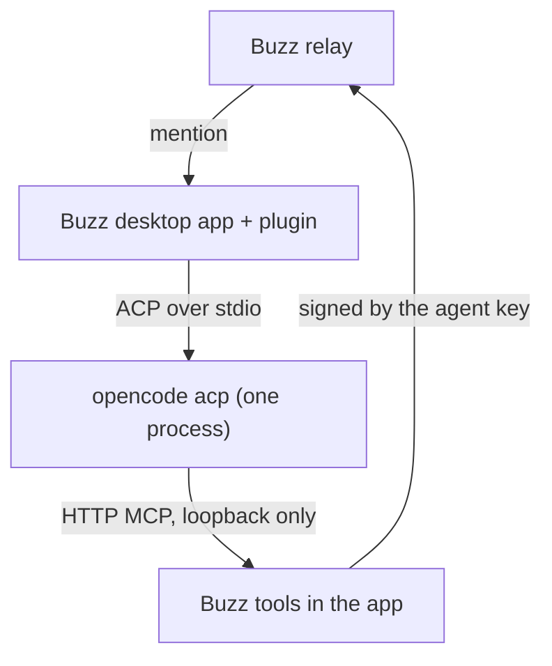

# buzz-plugin-opencode

Run [OpenCode](https://opencode.ai) agents in the Buzz desktop app. An
OpenCode agent answers mentions in Buzz channels and threads, as the app's
own Claude, Codex, Goose and Pi agents do.

## What it does

The plugin `sagmans.opencode` adds the agent type "OpenCode".

- All OpenCode agents share one `opencode acp` process on your computer.
  Each thread (or channel) that an agent works in is one OpenCode session.
- OpenCode gets the Buzz tools (read, send, react and the others) over a
  local MCP server on loopback. It never gets an agent key: the app signs
  each message with the agent's key.
- You pick the model from the list that `opencode models` prints, so every
  provider that you set up in OpenCode is available. "OpenCode default"
  uses the model from your OpenCode config.
- The turn, prompt and session rules come from the app's Goose agent type
  (see [NOTICE](NOTICE)), so OpenCode agents act as the app's own agents do.



## Requirements

- The Buzz desktop app, release `v0.7.0-preview.240.1` (plugin API
  version 1). The plugin bundles code from that release; see "Build".
- OpenCode on your login shell's `PATH`, signed in to at least one
  provider. OpenCode's free models need no key.
- To build: Node.js 24 or newer, pnpm 12, and a buzz-app clone.
  [mise](https://mise.jdx.dev) installs the pinned Node.js and pnpm from
  `mise.toml`.

## Build

The plugin is one file, `dist/plugin.js`. It bundles buzz-app modules
unchanged, from the exact app revision in `src/constants.ts`
(`BUZZ_APP_REV`).

```sh
mise install
pnpm install --frozen-lockfile
git clone https://github.com/block/buzz-app.git ../buzz-app
git -C ../buzz-app checkout <BUZZ_APP_REV>
(cd ../buzz-app && pnpm install --frozen-lockfile --ignore-scripts)
scripts/link-toolchain ../buzz-app
node scripts/build-plugin.mjs        # writes dist/manifest.json and dist/plugin.js
```

The build stops when the clone is at another revision or has local edits.

## Install

1. In the Buzz desktop app, open **Settings > Plugins**.
2. Select **Install from folder** and choose the `dist` folder.
3. Read the grant and accept it (see "Security").
4. Create an agent: **New agent**, type **OpenCode**. Pick a model and
   write instructions.
5. Mention the agent in a channel.

To update, build again and install the `dist` folder again.

## Settings

| Setting | Default | Purpose |
| --- | --- | --- |
| Model | OpenCode default | A `provider/model` from `opencode models`. |
| Instructions | Empty | Extra instructions for the agent, after Buzz's own. |
| Workspace | `~/.buzz` | The folder OpenCode works in. |
| Sessions | Each thread | One session per thread, or one for the whole channel. |

## Limits

- OpenCode runs with your own OpenCode config, providers and MCP servers.
  The plugin does not change them.
- The app allows every OpenCode permission request. There is no approval
  step and no sandbox (see "Security").
- `opencode models` can start OpenCode's background service, as OpenCode
  does on its own.
- No usage, cost or thinking-level display. OpenCode's ACP server does not
  report them in a form that the app reads.

## Security

- Buzz plugins are not sandboxed. They run inside the app with its full
  access. Install only code that you trust, and read `dist/plugin.js`
  first.
- The plugin asks for these native grants, and no network origins:

  | Grant | Use |
  | --- | --- |
  | Process `opencode acp` | The OpenCode agent process. |
  | Command `opencode models` | The model list. |
  | MCP | The Buzz tools for OpenCode, on loopback, behind a bearer token. |
  | Files | The agent's workspace folder. |

  Desktop shows these grants as full access. `scripts/check` fails when the
  manifest asks for anything more.
- OpenCode reads, writes and runs commands in the workspace as your user,
  with no approval step. Give an agent a workspace that holds only what it
  needs, and trust the people who can mention it.
- OpenCode starts without the agent's key and without the Buzz identity in
  its environment.

Report a security problem privately to the maintainers. Do not open a
public issue for it.

## Contributing

1. After you clone, run `scripts/setup-hooks` once. It turns on the Git
   hooks of this repository.
2. Install the tools that the hooks use: `gitleaks`, `node`, `pnpm`,
   `opencode`, `shellcheck`, `shfmt`, `markdownlint-cli2`, `lizard`,
   `semgrep`, `trivy`, `osv-scanner` and `sqlite3`.
3. Set up the build (see "Build").
4. Run `scripts/check` before you push. It checks the manifest grant and
   private data, runs the linters and the scanners, builds the plugin and
   runs the smoke scenario (`smoke/run.mjs`): a real `opencode acp`, in
   throwaway folders, answers a mention through the Buzz `send` tool. Its
   model is `SMOKE_MODEL` in `smoke/run.mjs`; log in to that provider with
   `opencode auth login` first. The smoke copies only that one login into
   the throwaway folders. `scripts/check --quick` runs the fast part.
5. Sign each commit and add a sign-off: `git commit -s -S`. The commit
   message rules are in `.githooks/GIT_CONVENTION.md`.

All checks must pass before you push. Never use `--no-verify`.

## License

Apache License 2.0. See [LICENSE](LICENSE) and [NOTICE](NOTICE). Parts of
the plugin come from Buzz (block/buzz-app); NOTICE lists them.
