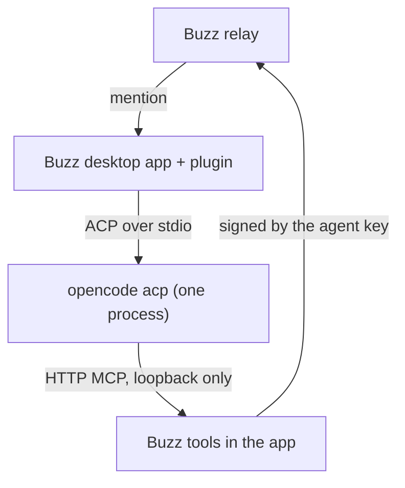

# buzz-plugin-opencode

Run [OpenCode](https://opencode.ai) agents in the Buzz desktop app. An
OpenCode agent answers mentions in Buzz channels and threads, as the app's
own Claude, Codex, Goose and Pi agents do.

## What it does

The plugin `sagmans.opencode` adds the agent type "OpenCode".

- All OpenCode agents share one `opencode acp` process on your computer.
  Each thread (or channel) that an agent works in is one OpenCode session.
- OpenCode gets the Buzz tools (read, send, react and the others) over a
  local MCP server on loopback. It never gets an agent key: the app signs
  each message with the agent's key.
- You pick the model from the list that `opencode models` prints, so every
  provider that you set up in OpenCode is available. "OpenCode default"
  uses the model from your OpenCode config. You can also pick a thinking
  level, for the agent or for one message, from the model's variants.
- The turn, prompt and session rules are the app's Goose agent type's own
  code, bundled unchanged; only its process adapter is OpenCode's (see
  [NOTICE](NOTICE)). So OpenCode agents act as the app's own agents do.
- The New agent dialog and the agent's settings use the app's own model
  picker, instructions field and settings rows, so they look as they do for
  the app's own agents.
- The Activity tab shows the agent's recent sessions and their transcripts.
  It reads them from OpenCode first, as the app's Goose agents read theirs,
  and the record that the plugin writes while a turn runs is the fallback (see
  "Activity record").



## Requirements

- The Buzz desktop app, release `v0.7.0-preview.243.1` (plugin API
  version 1). The plugin bundles code from that release; see "Build".
- OpenCode 2.2.4 on your login shell's `PATH` (the version the smoke scenario
  ran on), signed in to at least one provider. OpenCode's free models need no
  key. The plugin needs its `--standalone` flag for the model list.
- To build: Node.js 24 or newer, pnpm 12, and a buzz-app source clone. The
  clone needs no install: the build uses only this repository's packages, so
  this repository's lockfile, audit and minimum age cover the whole build.
  [mise](https://mise.jdx.dev) installs the pinned Node.js and pnpm from
  `mise.toml`.

## Build

The plugin is one file, `dist/plugin.js`. It bundles buzz-app modules
unchanged, from the exact app revision in `src/constants.ts`
(`BUZZ_APP_REV`).

```sh
mise install
pnpm install --frozen-lockfile
git clone https://github.com/block/buzz-app.git ../buzz-app
git -C ../buzz-app checkout <BUZZ_APP_REV>
scripts/link-toolchain ../buzz-app
node scripts/build-plugin.mjs        # writes dist/manifest.json and dist/plugin.js
```

The build stops when the clone is at another revision or has local edits.

## Install

1. In the Buzz desktop app, open **Settings > Plugins**.
2. Select **Install from folder** and choose the `dist` folder.
3. Read the grant and accept it (see "Security").
4. Create an agent: **New agent**, type **OpenCode**. Pick a model and
   write instructions.
5. Mention the agent in a channel.

To update, build again and install the `dist` folder again.

## Settings

| Setting | Default | Purpose |
| --- | --- | --- |
| Model | OpenCode default | A `provider/model` from `opencode models`. |
| Thinking | Default | One of the variants OpenCode offers for that model. A saved `provider/model/variant` keeps working and shows as model and level. |
| Instructions | Empty | Extra instructions for the agent, after Buzz's own. |
| Workspace | `~/.buzz` | The folder OpenCode works in. |
| Sessions | Each thread | One session per thread, or one for the whole channel. |

## OpenCode row in the app's settings

The app's agent settings show a row for OpenCode, with OpenCode's default
model when all is well, or the action to take when not. Its dialog shows if
OpenCode is installed and answers, its version, its default model and its
models. To do this, it runs `opencode acp` and `opencode --standalone models`
for a short time when the settings open. Both use a private server, so the
plugin never starts or uses OpenCode's background service. No model runs and no
session stays.

A check that found all well stands for 5 minutes, so opening the settings again
starts nothing. A check that found a problem does not stand. **Check again** in
the dialog always reads afresh, for example just after `opencode auth login`.

The row only shows these. To change a login or the default model, use
`opencode auth login` and OpenCode's config. The plugin does not read or keep
your provider keys.

## Activity record

A transcript reads its session from OpenCode first, as the app's Goose agents
do. A short-lived `opencode acp` process replays the session (`session/load`),
with a timeout, and stops after the read. It goes on no record, and no text is
cut. A transcript shows the last 50 turns, says when older turns exist, and
joins up to 10 sessions of one conversation.

The plugin also writes a record while a turn runs: the messages between the app
and OpenCode, as the app's own agents' transcripts show them. The tab shows the
record for the session that runs now, which updates live, and for a session
whose read fails or that OpenCode no longer has. A failed read shows an alert
above the record. A turn read from OpenCode takes its times, its end and its
steers from the record.

The app's token and cost view reads each request's counts and cost from
OpenCode's store, child sessions included, also for sessions from before this
plugin. The record fills in only a session the store cannot read. The store has
no read over ACP that does not replay a session, so each request is one short
`opencode --standalone api` GET process, the same grant that steering uses. At
most 4 run at once, and a session is read again only after OpenCode updated it.

Replies show with Markdown layout, as in the app's own Activity. A remote image
shows as its alt text and does not load, and raw HTML does not run.

- It holds **private data**: prompts with chat text and tool calls with what
  the agent read and wrote.
- It stays on this computer, in the app's agent storage. The plugin never
  sends it anywhere and does not write it to a file.
- It is bounded: the last 50 turns of each conversation, about 1 MB for each
  agent, with long text cut. The oldest turns go first.
- It holds no agent key and no MCP token: requests that carry credentials are
  not recorded.
- It stays after you remove an agent, until the app deletes its storage.
- The plugin also logs each session's id, conversation and workspace in the
  app's local storage, so that the tab can read it. The log holds no chat text.
- Costs come from OpenCode. They are empty for a turn when OpenCode reports
  no cost, for example when the provider's plan has no per-call price.

## Limits

- Buzz draws icons only for its bundled plugins, so this plugin adds its own to
  its row and details panel in Settings, by editing that page. The build checks
  the page at the pinned app revision. If a newer app changes the page, the app's
  generic icon comes back; nothing else breaks.
- OpenCode runs with your own OpenCode config, providers and MCP servers.
  The plugin does not change them.
- The app allows every OpenCode permission request. There is no approval
  step and no sandbox (see "Security").
- The New agent dialog and the agent's settings use the app's own
  components. One part is different: the Settings tab shows its own Save
  button, and the app does not warn about unsaved changes when you leave
  the tab. The plugin API does not give that part to plugins.
- An agent cannot set a static WebP picture that needs a pixel change. The
  app does that work in a web worker, and an installed plugin is one file.
  The tool tells the agent to use a PNG or JPEG. PNG, JPEG and GIF work.
- The Activity tab reads only logged sessions, in the workspace the log names,
  because OpenCode loads a session only in its own folder. A recorded session
  with no log row shows from the record, where long text is cut and older turns
  drop out.
- The tab also adds sessions from OpenCode's session list when their first
  prompt names the agent, as Goose does. It checks only the agent's current
  workspace, and at most 15 sessions each time it opens. Others do not show
  until a later check reaches them.
- A turn from OpenCode that is not on the record has no times and no end state.
  A recorded steer that a replay does not hold shows with its record
  text, which starts with "Note:".
- A session with no title shows as a short id, because the plugin API does not
  give channel names to this tab.
- An open transcript replaces the Activity tab's content, with a back button.
  The app's own agents open it in a panel tab. The plugin API does not give
  that part of the app to plugins.
- A level picked for one message ends with that message: the next message
  without a pick opens a new session, as for the app's Goose agents.
- A message sent while a turn runs reaches the model at its next step. If the
  steer fails, or the message is longer than 100 kB, it runs as the next turn.
  A steer that arrives in the moment after the model's last step can wait for
  the session's next message.
- Steering uses a second private OpenCode server on the same database (see
  "Security"). OpenCode does not promise that this works. The smoke scenario
  proves it on OpenCode 2.2.4 only. Check it again on each OpenCode update.
- The record holds no steered message, so a transcript from the record does
  not show it. The reply to it shows. A transcript read from OpenCode shows it
  as OpenCode kept it. The smoke run logs how many steers show in that read.
- A failure in the bundled turn logic writes a line that starts with "goose" to
  the app's developer console. The owner never sees this text in the app. The
  turn logic is bundled unchanged, so the plugin cannot change these lines.

## Security

- Buzz plugins are not sandboxed. They run inside the app with its full
  access. Install only code that you trust, and read `dist/plugin.js`
  first.
- The plugin asks for these native grants, and no network origins:

  | Grant | Use |
  | --- | --- |
  | Process `opencode acp` | The OpenCode agent process. |
  | Process `opencode --standalone api` | One short process for each steer, with a request that the plugin writes. |
  | Command `opencode --standalone models` | The model list, from a private server. |
  | MCP | The Buzz tools for OpenCode, on loopback, behind a bearer token. |
  | Files | The agent's workspace folder. |

  Desktop shows these grants as full access. `scripts/check` fails when the
  manifest asks for anything more.
- The `api` grant lets the plugin send any OpenCode API request to a private
  server on your OpenCode database, with your sessions and logins. OpenCode
  refuses `--server` beside `--standalone`, so this grant cannot reach the
  background service or another server. The plugin sends only two requests:
  admit a steer, and take back a steer that came too late. It opens no port
  and holds no server password.
- A steer's message is in that process's arguments for under a second, because
  OpenCode's `--data` flag reads no stdin. Other programs of your user can read
  it there. The activity record does not hold this process's output.
- OpenCode reads, writes and runs commands in the workspace as your user,
  with no approval step. Give an agent a workspace that holds only what it
  needs, and trust the people who can mention it.
- OpenCode starts without the agent's key and without the Buzz identity in
  its environment.

Report a security problem privately to the maintainers. Do not open a
public issue for it.

## Contributing

1. After you clone, run `scripts/setup-hooks` once. It turns on the Git
   hooks of this repository.
2. Install the tools that the hooks use: `gitleaks`, `node`, `pnpm`,
   `opencode`, `shellcheck`, `shfmt`, `markdownlint-cli2`, `lizard`,
   `semgrep`, `trivy`, `osv-scanner` and `sqlite3`.
3. Set up the build (see "Build").
4. Run `scripts/check` before you push. It checks the manifest grant and
   private data, runs the linters and the scanners, builds the plugin and
   runs the smoke scenario (`smoke/run.mjs`): a real `opencode acp`, in
   throwaway folders, answers a mention through the Buzz `send` tool and takes
   a steer during a turn. First, a stand-in process (`smoke/stub.mjs`) shows the
   session reads that real OpenCode cannot show on demand; `--stub-only` runs
   only that part, with no model call. Its
   model is `SMOKE_MODEL` in `smoke/run.mjs`; log in to that provider with
   `opencode auth login` first. The smoke copies only that one login into
   the throwaway folders. `scripts/check --quick` runs the fast part.
5. Sign each commit and add a sign-off: `git commit -s -S`. The commit
   message rules are in `.githooks/GIT_CONVENTION.md`.

All checks must pass before you push. Never use `--no-verify`.

## License

Apache License 2.0. See [LICENSE](LICENSE) and [NOTICE](NOTICE). Parts of
the plugin come from Buzz (block/buzz-app); NOTICE lists them.
